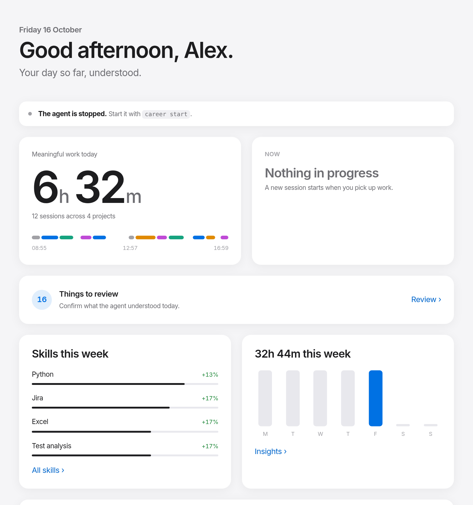
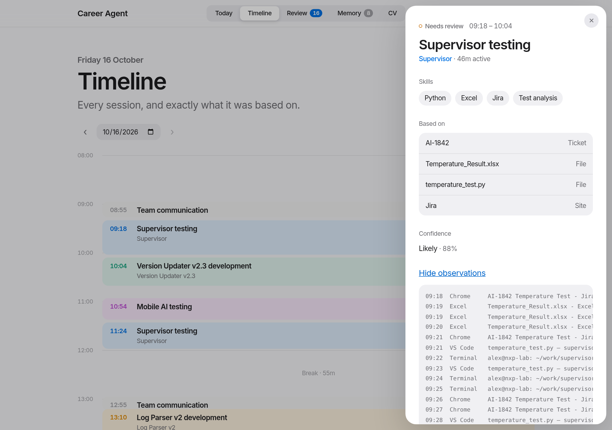
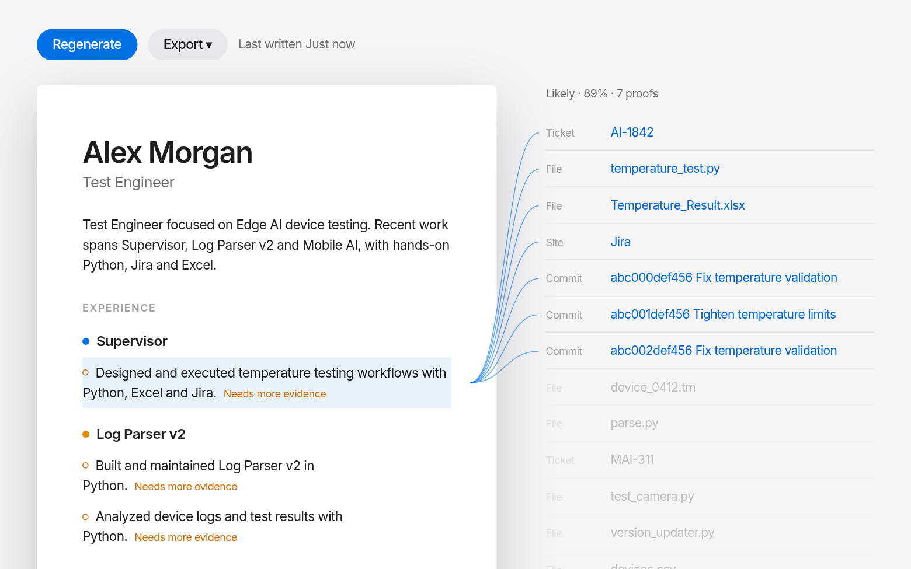
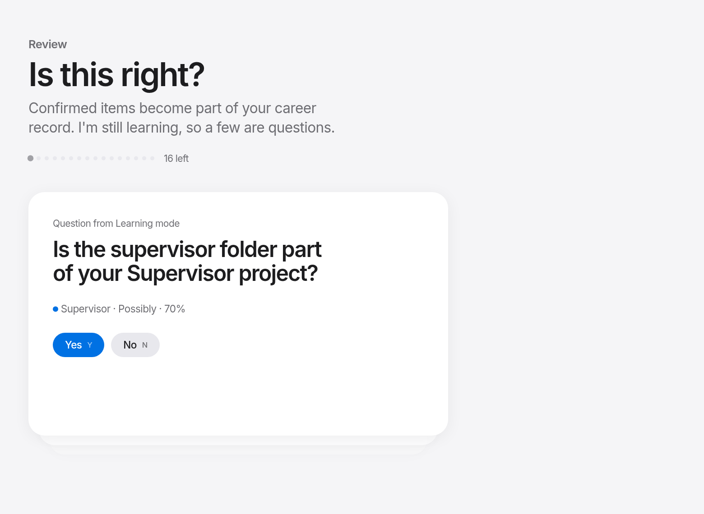
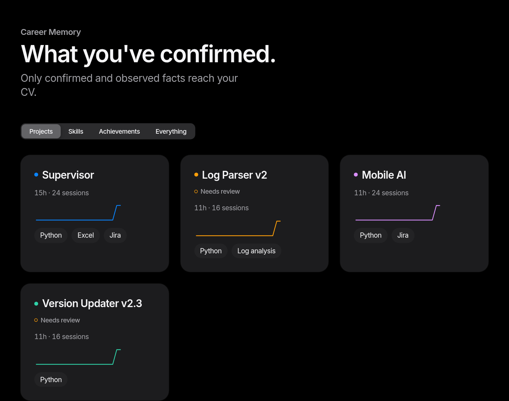
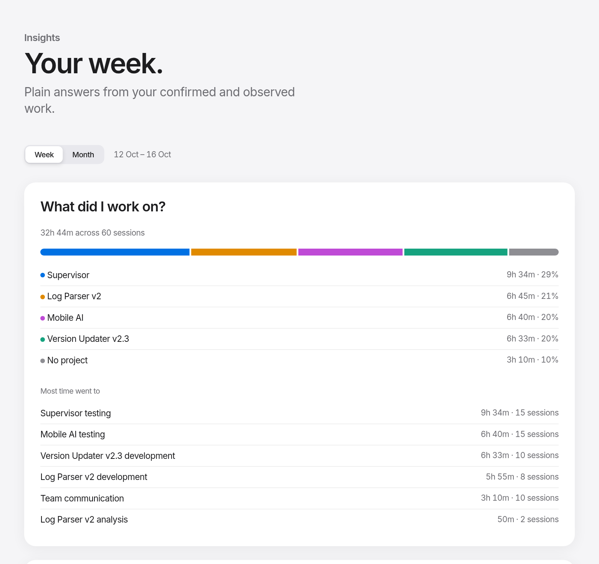
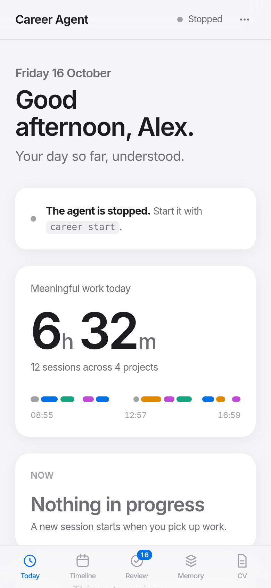

<div align="center">

# Career Agent

### Your work, remembered.

**A local-first AI agent that quietly turns your everyday computer work into a living career record and a CV where every line is backed by real evidence.**

[](https://github.com/Kutluhankurt/career-agent/actions/workflows/ci.yml)
[](LICENSE)


[](#-help-build-it)



</div>

---

## Why?

Ask anyone what they accomplished last quarter and they'll struggle. The work happened: the bug
hunts, the test campaigns, the tooling nobody asked for. It just was never written down.

Time trackers don't help. They tell you *"VS Code: 3h 21m"*. That's not a career.

Career Agent tells you this instead:

```
09:12–10:04  Supervisor temperature testing                     Likely · 88%
             Supervisor · Testing
             Skills    Python · pytest · Test analysis · Jira
             Based on  AI-1842 · temperature_test.py · pytest · Temperature_Result.xlsx
                       abc123 "Fix temperature validation"
```

…and months later, it writes your CV from it:

> **Supervisor Platform**
> - Designed and executed temperature testing workflows with Python, Excel and Jira.
> - Investigated and validated temperature test behaviour in Supervisor.

Every one of those bullets links back to the tickets, files and commits that prove it. Nothing is invented.

## What it does

<table>
<tr>
<td width="50%" valign="top">

**👀 Observes, without spying**
The focused window, idle time, file saves (names only) and Git commits. Never keystrokes,
screenshots, passwords, microphone or camera.

**🧩 Understands sessions**
500 raw events become ~12 meaningful work sessions, with deterministic rules first and AI only where the rules are unsure.

**🧠 Remembers your career**
Projects, skills and achievements grow into a **Career Memory** with a truth state on every
fact: *observed · inferred · confirmed · rejected*.

</td>
<td width="50%" valign="top">

**✅ Learns from you**
A 30-second daily review (`Y` / `E` / `N`) confirms what it understood. Once you've confirmed a pattern, it stops asking.

**📄 Proves it**
A CV in Markdown, Word, PDF or JSON. Hover any line in the dashboard to see what backs it.
AI may polish wording, but it can never add a number.

**🔒 Stays yours**
Local SQLite, no account, no cloud. Export, back up or delete everything with one command.

</td>
</tr>
</table>

## A look inside

<table>
<tr>
<td></td>
<td></td>
</tr>
<tr>
<td align="center"><sub><b>Timeline</b>: every session, and exactly what it was based on</sub></td>
<td align="center"><sub><b>CV</b>: point at a line to see what proves it</sub></td>
</tr>
<tr>
<td></td>
<td></td>
</tr>
<tr>
<td align="center"><sub><b>Review</b>: confirm, edit or reject in seconds</sub></td>
<td align="center"><sub><b>Career Memory</b>: projects, skills, achievements (dark mode)</sub></td>
</tr>
</table>

<details>
<summary><b>More: Insights and phone layout</b></summary>
<br>


</details>

<sub>Screenshots use the bundled demo data (`scripts/seed_demo.py`).</sub>

## Quick start

```bash
git clone https://github.com/Kutluhankurt/career-agent.git
cd career-agent
./scripts/install.sh            # macOS / Linux, installs the `career` command (no root)
career setup                    # role, projects, tools, AI provider: 1 minute
career start                    # starts observing in the background
```

<details>
<summary>Windows, AI extras and development installs</summary>

```powershell
powershell -ExecutionPolicy Bypass -File scripts\install.ps1
```

```bash
CAREER_AGENT_EXTRAS=claude ./scripts/install.sh   # or openai, gemini, all-ai
uv sync --extra claude && uv run career --help    # run from the checkout without installing
```

Linux needs `xprop` (`sudo apt install x11-utils`). macOS asks for the Accessibility
permission the first time it reads window titles.
</details>

Then, during your day:

```bash
career status        # is it running? what's the current window?
career today         # meaningful work, sessions, projects, top skills
career review        # confirm what it understood (Y / E / N)
career dashboard     # the UI above, at http://127.0.0.1:7342
career cv --format pdf
```

Want to try it without recording anything? Load ten days of demo work:

```bash
CAREER_AGENT_HOME=/tmp/demo uv run python scripts/seed_demo.py
CAREER_AGENT_HOME=/tmp/demo uv run career dashboard
```

<details>
<summary><b>All commands</b></summary>

| Command | What it does |
|---|---|
| `career setup` | first-run questions (also in the dashboard) |
| `career start` · `stop` · `pause 60` · `resume` · `status` | control the background agent |
| `career events --today` · `sessions` | what was observed / how it was grouped |
| `career today` · `review` | your day and the review queue |
| `career analyze [--days N] [--deep]` | (re)analyse recent days; `--deep` asks the AI about every session |
| `career analyze --week` · `--month` | what you worked on, skills that grew, achievements, patterns |
| `career skills` · `projects` · `achievements` · `memory` | Career Memory |
| `career cv [--format md\|pdf\|docx\|json] [--regenerate]` | your evidence-backed CV |
| `career dashboard` | local web UI |
| `career config` · `config ai` · `config set section.key value` | settings, AI provider, keychain key |
| `career export --format json\|csv\|md` · `import` · `backup` · `restore` | your data, portable |
| `career autostart on\|off` | start at login |
</details>

## How it works

```
 Your computer                                   Career Agent (all local)
┌──────────────┐   ┌────────────┐   ┌──────────────┐   ┌──────────────┐   ┌──────────────┐
│ windows      │   │ normalized │   │   Session    │   │   Context    │   │  Rules first │
│ idle / sleep ├──▶│   events   ├──▶│    Engine    ├──▶│   Builder    ├──▶│  AI if unsure│
│ files · git  │   │  (SQLite)  │   │  (no AI)     │   │ files·git·…  │   │  (validated) │
└──────────────┘   └────────────┘   └──────────────┘   └──────────────┘   └──────┬───────┘
                                                                                  ▼
          ┌──────────┐   ┌──────────────┐   ┌───────────────────────────────────────────┐
          │    CV    │◀──│  You review  │◀──│ Career Memory: projects · skills ·         │
          │ evidence │   │  Y / E / N   │   │ achievements · evidence · truth states    │
          └──────────┘   └──────────────┘   └───────────────────────────────────────────┘
```

- **Rules before AI.** Sessions, projects and a first classification are deterministic, so it works fully offline and costs nothing.
- **AI is a guest, not the source of truth.** It receives one structured context packet per session, must answer in a strict schema, and anything it cites that isn't in the context is thrown away.
- **Evidence or it didn't happen.** Achievements need a real story (problem → investigation → implementation → testing → verification), and impact numbers come only from you.
- **Pluggable providers.** Claude, OpenAI, Gemini, local models through Ollama, or none at all.

More detail: [ROADMAP.md](ROADMAP.md) (status) · [docs/DASHBOARD_UX.md](docs/DASHBOARD_UX.md) (UI/UX) · [docs/API.md](docs/API.md) (local API) · [docs/ROADMAP.txt](docs/ROADMAP.txt) (master plan)

## Privacy, by design

| ✅ Collected (locally) | ❌ Never collected |
|---|---|
| App name and window title of the focused window | Keystrokes, clipboard, passwords |
| Idle / active time | Screenshots, screen recording |
| File **names** you save inside your repositories | File **contents** |
| Git commit messages, changed files, line counts | Microphone, camera, location |

Titles that look like secrets (`sk-…`, `ghp_…`, `password=…`) are redacted before storage.
Incognito windows, password managers and apps you exclude are stored only as "Private".
`career pause` stops everything. API keys live in your OS keychain, never in files or logs.

## 🤝 Help build it

**Career Agent is young, open source, and I'd love your help.** Whether you want to fix a typo or
build a whole new collector, you're welcome here. Some places where help would make a real difference:

- 🪟 **Windows & 🍎 macOS testers.** The collectors are written but need real-world mileage.
  Running `uv run pytest -m platform` and using it for a day is a huge contribution.
- 🧭 **Wayland support.** Native Wayland windows aren't visible today (GNOME / KDE extensions?).
- 🧩 **New context sources.** Browser extension, IDE plugins, Jira / GitHub / Linear integrations (optional, never required).
- 🧠 **Smarter understanding.** Better session rules, achievement detection, skill taxonomy, prompts.
- 🌍 **Translations.** The UI is English-first; Turkish (and more) is planned.
- 🎨 **Design & UX.** The dashboard aims for calm and simple. Ideas and polish welcome.
- 📦 **Packaging.** Signed binaries, Homebrew, winget, AUR.

Start with [CONTRIBUTING.md](CONTRIBUTING.md), pick an issue labelled
[`good first issue`](https://github.com/Kutluhankurt/career-agent/labels/good%20first%20issue), or open one with your idea.

### 💬 Get in touch

**Want to help shape it, have an idea, or just want to talk about it? Reach out. I read everything.**

- 💡 Ideas and questions: [GitHub Discussions](https://github.com/Kutluhankurt/career-agent/discussions)
- 🐛 Bugs and feature requests: [GitHub Issues](https://github.com/Kutluhankurt/career-agent/issues)
- 👋 Me: [@Kutluhankurt](https://github.com/Kutluhankurt) on GitHub

If Career Agent sounds useful to you, a ⭐ helps others find it.

## Project status

The full plan (Sprints 1–11) is implemented. Linux is tested end-to-end (150 Python + 26 UI tests,
platform smoke tests, standalone binary). Windows and macOS collectors are written and covered by CI unit
tests, but haven't had real-world use yet. See [ROADMAP.md](ROADMAP.md) for the honest checklist.

<details>
<summary><b>Development</b></summary>

```bash
uv sync --extra claude
uv run pytest                    # unit + integration
uv run pytest -m platform        # smoke tests against your real desktop
cd dashboard && npm install && npm run dev:mock    # UI against mock data
cd dashboard && npm run build    # builds into src/career/server/static
uv run --with pyinstaller python scripts/build_binary.py   # standalone binary for this OS
```

```
src/career/
├── cli/          Typer commands
├── collector/    Linux / Windows / macOS / Mock collectors, files, Git
├── events/       event model, app-name normalizer, privacy filters
├── analysis/     signals, Session Engine, context builder, classifier
├── ai/           provider interface: Claude, OpenAI, Gemini, Local; keychain
├── career/       Career Memory: projects, skills, achievements, review, CV
├── server/       FastAPI local API + built dashboard
└── …             database, config, profile, agent, autostart, data
dashboard/        React + Vite + TypeScript UI
```
</details>

## License

[MIT](LICENSE) © Kutluhan Kurt
